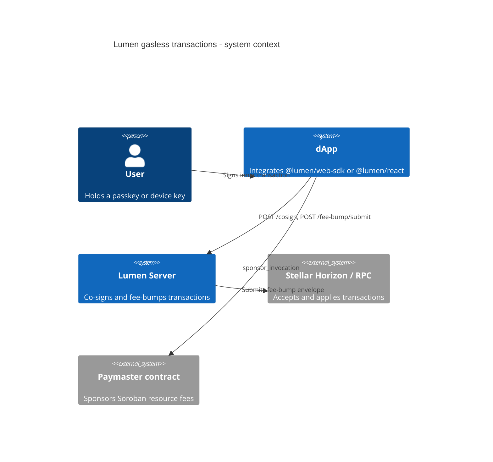
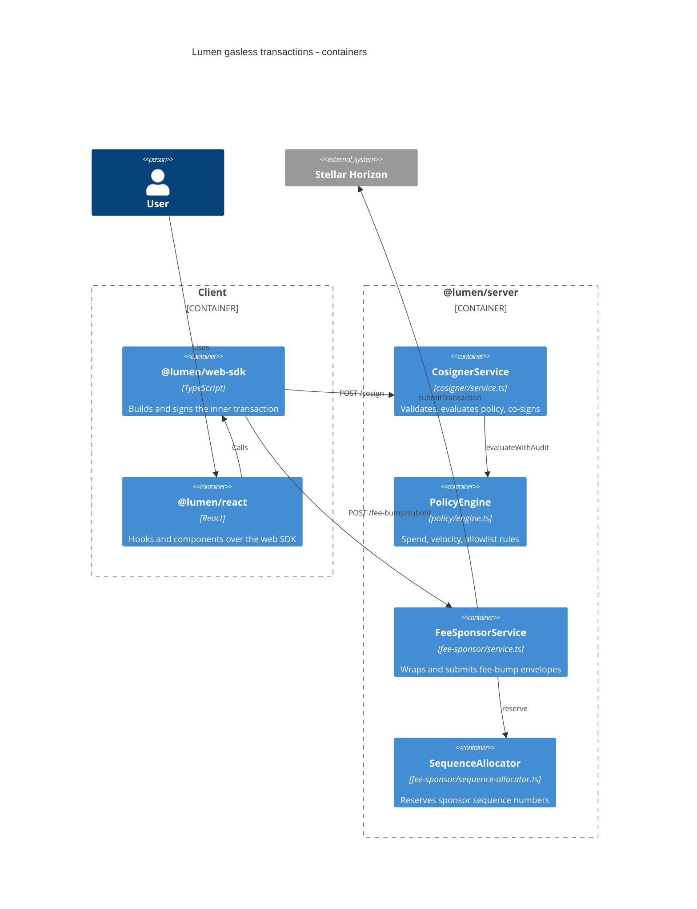
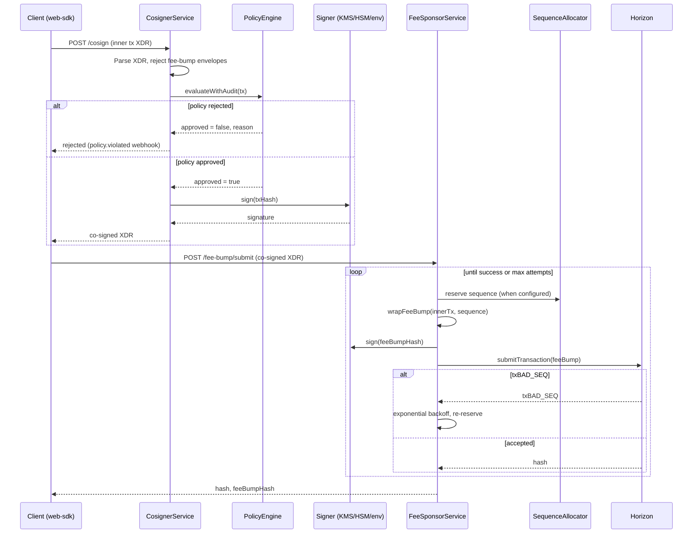

# Gasless Fee-Bump Architecture

Lumen removes gas friction from Stellar transactions:

1. The client signs an inner transaction with fee = 0.
2. The server wraps the transaction in a \`FeeBumpTransaction\`.
3. The server signs as the fee payer and submits to the network.
4. The user's account never holds or expends XLM for transaction fees.

## System Context

## Containers

## Cosign and Fee-Bump Sequence

## On-Chain Paymaster Contract

While the fee-bump flow above sponsors classic Stellar transaction envelope fees off-chain, Soroban contract invocations consume CPU and memory resource fees that are better handled on-chain. The Paymaster contract (located in \`contracts/paymaster/\`) provides an on-contract fee credit ledger that lets dApps sponsor Soroban contract user invocations.

### Deposits

dApps (sponsors) deposit XLM or supported stablecoins into the Paymaster contract. Deposited funds form the sponsorship pool from which invocation fees are credited. Each deposit increases the sponsor's available balance held by the contract.

### Sponsoring Invocations

The core entry point is:

\`\`\`
sponsor_invocation(user: Address, contract: Address, function_name: Symbol, max_fee: i128)
\`\`\`

This authorizes the Paymaster to cover up to \`max_fee\` for the given \`user\` invoking \`function_name\` on \`contract\`. The requested fee is deducted from the sponsorship pool, subject to the per-user spend limits described below. If the request would exceed the user's remaining allowance for the current epoch, the call is denied.

### Per-User, Per-Epoch Spend Limits

To bound exposure, the Paymaster enforces a spend limit per user per epoch. Each user has a maximum amount of fees the Paymaster will sponsor within a single epoch. Once the user's cumulative sponsored fees for the epoch reach the limit, further \`sponsor_invocation\` calls for that user are rejected until the next epoch begins. This protects sponsors from runaway costs and abuse.

### \`PaymasterSponsorship\` Events

Every successful sponsorship emits a \`PaymasterSponsorship\` event capturing the sponsorship details (user, target contract, function, and sponsored fee amount). These events provide an auditable, indexable trail of all sponsored invocations for sponsors and integrators.

### Owner Withdrawal

The contract owner is authorized to withdraw remaining deposited balances from the Paymaster. Withdrawals are restricted to the owner, ensuring that sponsorship funds can only be reclaimed by an authorized party.

### Relationship to the Off-Chain Fee-Bump Flow

The two mechanisms are complementary:

- **Off-chain fee bumps** cover the base transaction envelope fees for classic Stellar operations, keeping the user's account free of XLM fee requirements at the network level.
- **On-chain Paymaster** covers Soroban resource fees (CPU and memory) for contract invocations, with granular per-user, per-epoch accounting and auditable sponsorship events.

Together they provide end-to-end gasless UX: the fee-bump flow gets the transaction onto the ledger, and the Paymaster sponsors the contract execution resources consumed by Soroban invocations.