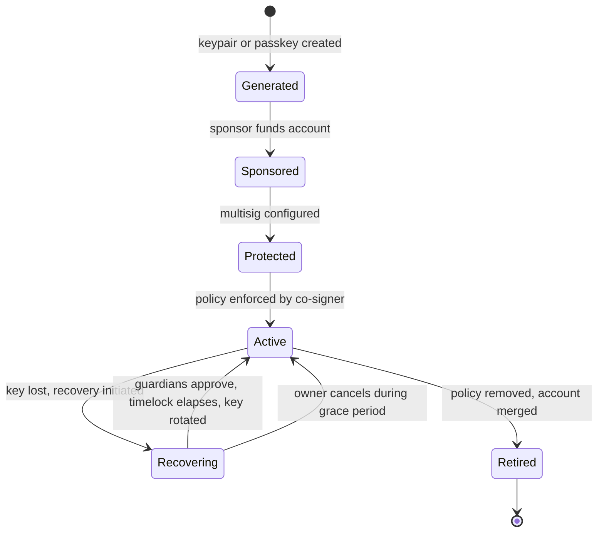
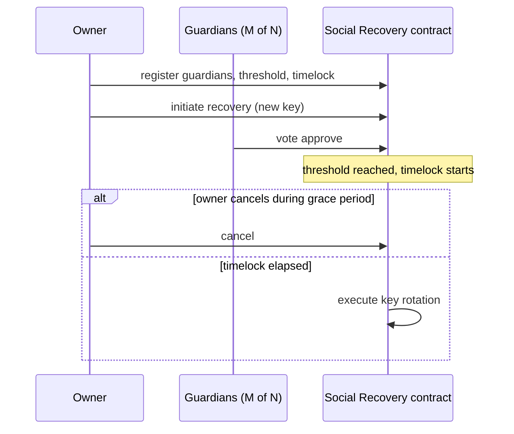
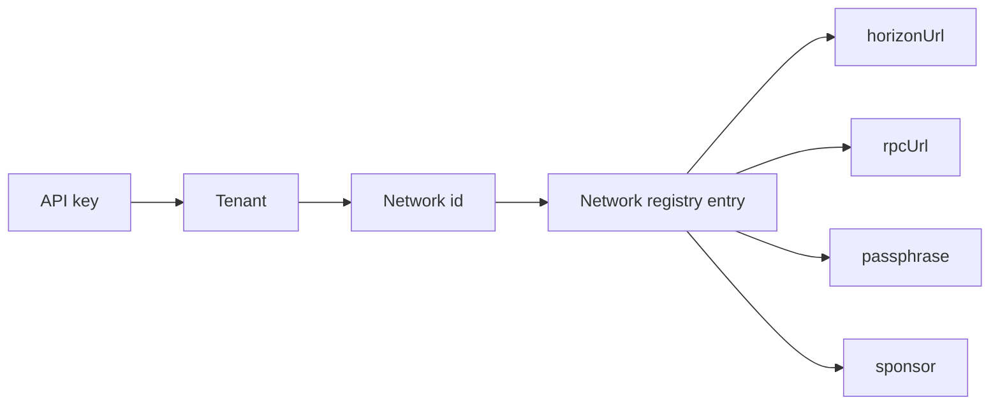

# Wallet Lifecycle

Lumena wallets move through four operational states:

1. Generated: a local keypair or passkey credential is created.
2. Sponsored: the sponsor account funds the wallet and pays the setup fee.
3. Protected: multisig is configured so the server co-signer enforces policy.
4. Active: payments, contract calls, and sponsored fee-bump submissions are available.



Recovery and closure should keep policy in sync with on-chain state. When a wallet is retired, remove stored policy, stop sponsor monitoring for the account, and use account merge only after balances, trustlines, and claimable balances are cleared.

## Social Recovery

Seedless wallets rely on social recovery so that a lost passkey or device key can be restored without a centralized server holding custody. The Social Recovery contract (`contracts/social-recovery/`) implements this as an M-of-N guardian scheme with a configurable timelock.

### Guardian Registration

The wallet owner registers N guardian addresses (for example emails, friends, or secondary devices) and configures:

- An M-of-N threshold: at least M guardians must approve a recovery before it can execute.
- A configurable timelock (e.g., 48 hours) that defines the grace period between a recovery reaching threshold and its execution.

Guardian registration and threshold/timelock configuration are owner-controlled and keep the on-chain recovery policy in sync with the wallet's protected state.

### Recovery Initiation

When the owner loses access to their key, a recovery is initiated against the wallet, proposing a new key (key rotation target). Initiation opens a recovery proposal that guardians can vote on.



### Guardian Voting

Registered guardians vote to approve the proposed recovery. Once the number of approving guardians reaches the M-of-N threshold, the recovery becomes eligible for execution, subject to the timelock.

### Timelock Grace Period

After the threshold is met, the recovery must wait for the configured timelock to elapse before it can be executed. This grace period gives the legitimate owner time to notice an unauthorized recovery attempt.

### Owner Cancellation

During the grace period, the legitimate owner can cancel the pending recovery. Cancellation aborts the proposal so that the key rotation is never executed, protecting the wallet from malicious or mistaken recovery attempts.

### Execution of Key Rotation

Once the timelock has elapsed and the recovery has not been cancelled, execution performs the key rotation, replacing the lost key with the proposed new key. The wallet then returns to its normal lifecycle states (Protected and Active) under the new key, with recovery policy intact.

### Fit Within the Seedless Wallet Lifecycle

Social recovery complements the four operational states above: it is configured while the wallet is Protected, remains dormant while Active, and is invoked when a key is lost. Because recovery is enforced on-chain by the guardian contract rather than by a server, restoring account ownership does not reintroduce centralization. As with other lifecycle transitions, recovery and any resulting policy changes should keep off-chain policy in sync with on-chain state.

## Multi-Network Tenants

A single server instance can serve tenants on different Stellar networks (for example testnet and mainnet) at the same time. Instead of a single process-wide `STELLAR_NETWORK`, the backend resolves network settings per tenant through a **network registry**.

### Network Registry

The registry holds one entry per configured network, keyed by a network id (e.g. `testnet`, `mainnet`). Each entry defines everything needed to talk to that network:

- `horizonUrl`: Horizon endpoint used for account, transaction, and payment operations.
- `rpcUrl`: Soroban RPC endpoint used for contract calls and simulation.
- `passphrase`: the network passphrase, used to sign and verify transactions.
- `sponsor`: the sponsor account (and its signing key) that funds wallets and pays setup fees.

Every tenant (and therefore every API key) is bound to exactly one network id. When a request is authenticated, the API key is resolved to its tenant, the tenant to its network id, and the network id to its registry entry. All downstream operations — wallet generation, sponsorship, multisig setup, fee-bump submission, and recovery — use the resolved entry rather than any global setting.



### Isolation Guarantees

Network resolution is tenant-scoped, so tenants on different networks are isolated from each other:

- A request authenticated with a tenant's API key can only read or write state on that tenant's network. There is no fallback to a default or "primary" network.
- Sponsor accounts, signing keys, and fee-bump submissions are per-network; a sponsor configured for one network is never used to fund wallets on another.
- Wallet records, transaction records, and policy state are stored with their network id, and lookups are scoped by it. A wallet created on testnet is not visible to a mainnet tenant even if the account ids collide.
- Passphrases are taken from the resolved entry, so a transaction built for one network cannot be signed or submitted against another.
- If a tenant's network id is missing from the registry, the request fails closed with a configuration error rather than silently using another network.

### Configuration

Networks are declared in configuration and tenants reference them by id. The legacy single-network `STELLAR_NETWORK` variable is treated as the default network for tenants that do not specify one, preserving existing single-network deployments.

```jsonc
{
  "networks": {
    "testnet": {
      "horizonUrl": "https://horizon-testnet.stellar.org",
      "rpcUrl": "https://soroban-testnet.stellar.org",
      "passphrase": "Test SDF Network ; September 2015",
      "sponsor": {
        "publicKey": "GTESTNETSPONSOR...",
        "secretKeyEnv": "TESTNET_SPONSOR_SECRET"
      }
    },
    "mainnet": {
      "horizonUrl": "https://horizon.stellar.org",
      "rpcUrl": "https://soroban-mainnet.stellar.org",
      "passphrase": "Public Global Stellar Network ; September 2015",
      "sponsor": {
        "publicKey": "GMAINNETSPONSOR...",
        "secretKeyEnv": "MAINNET_SPONSOR_SECRET"
      }
    }
  },
  "tenants": [
    { "id": "acme-test", "apiKeyEnv": "ACME_TEST_API_KEY", "network": "testnet" },
    { "id": "acme-prod", "apiKeyEnv": "ACME_PROD_API_KEY", "network": "mainnet" }
  ]
}
```

Sponsor secret keys are referenced by environment variable name and never stored inline, so each network's sponsor key can be rotated independently.
